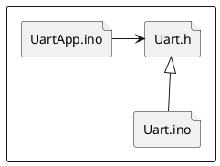

# UART Driver

## APIs to Implement

```c
void Uart_Init(void);
void Uart_SetBaudRate(unsigned short BuadRate);
void Uart_SendChar(unsigned char DataByte);
unsigned char Uart_ReadData();
void Uart_SendString(char DataString[], unsigned char Size);
```

## Driver File Structure

